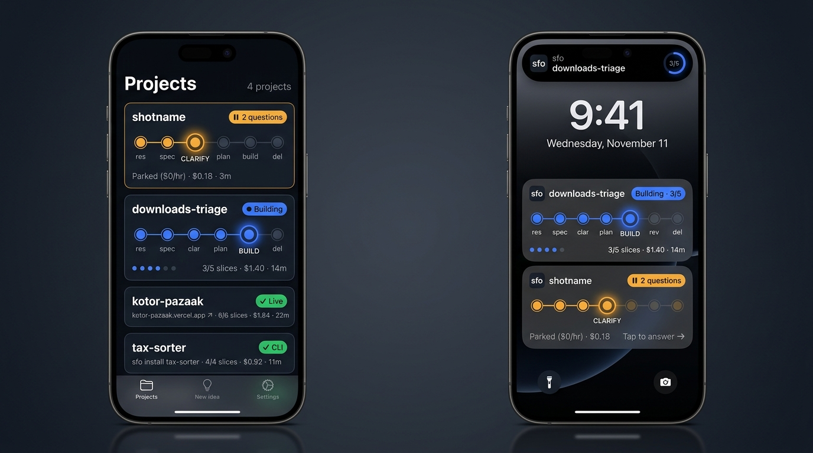
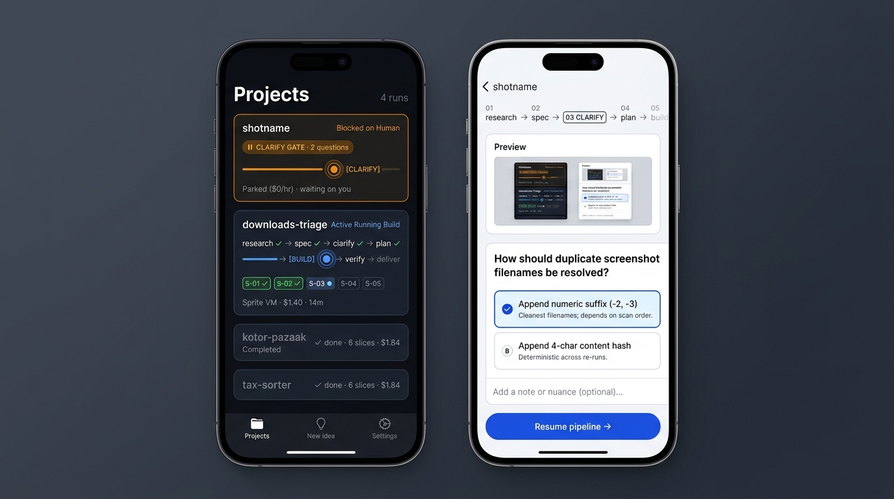

# App Theme — Spec

**Status:** Design approved, pre-implementation
**Date:** 2026-11-11
**Applies to:** `app/`, `ProjectSummary` (`src/commands/status.ts`,
`src/api/types.ts`), progress reporting from Sprites (`src/core/notify.ts`,
`src/server/workers.ts`), project creation (`src/server/projects.ts`)

---

## 1. Direction: Living Process

Almost everything sfo does happens out of sight on a remote Sprite. The app's
job is to make that invisible progress tangible at a glance, get out of the way
while you read specs or judge drafts, and make it unmistakable when a run is
waiting on you. You open it to drop an idea and leave; it calls you back when
it needs you.

- **Surfaces stay neutral** (deep carbon-slate in dark mode, cool lab-white in
  light mode, crisp `1px` borders) so long reports are easy to read and light
  or dark `Artifacts` screenshots are framed without a colour cast.
- **The pipeline carries the personality:** active and parked runs show a
  single-line stage track with a soft radial halo on **only** the current
  stage node — warm amber when blocked on you, electric cobalt when running.
  This is the one bold element; everything around it is quiet.
- **Prose vs. telemetry:** human words (titles, questions, summaries,
  decisions) sit in proportional sans; machine facts (stages, slice counts,
  spend, durations, commands, logs) use tabular monospace.

## 2. Reference renders

### Projects (dark) & future Lock Screen Live Activities

### Questions / Clarify (light, right phone)

### Where to depart from the renders

The renders are a direction, not a pixel target. Deliberate departures:

1. **Tinted translucent badges, not solid opaque pills.** No "traffic light"
   column of solid yellow, blue and green blocks down the right edge: subtle
   translucent fills with coloured text and a fine border (closer to the
   `CLARIFY GATE` pill in the second image), so `done` badges don't shout as
   loudly as `2 questions`.
2. **Small inactive stage dots; only the current node is enlarged.** Past and
   future stages are compact dots along the line; size and halo are reserved
   for the active stage so the rail doesn't dominate card height.
3. **No stage abbreviations (`res`, `clar`, `del`).** `del` reads like delete.
   Inactive dots are unlabeled; only the active node is labeled, underneath,
   with its full name in sentence case (`Research`, `Spec`, `Clarify`, `Plan`,
   `Build`, `Verify`, `Deliver`), as on the bottom Lock Screen card.
4. **Telemetry in fixed columns, not dot-joined strings.** The renders' footer
   `3/5 slices · $1.40 · 14m` becomes aligned monospace fields (slices, spend,
   time) in the same slots on every card, so the eye scans them down the list
   like a readout.
5. **No arrows appended to button text** (`Resume pipeline →`). A button says
   what it does: `Send answers`.

## 3. Design tokens

### Colour

Semantic colour only: every hue means a state. Neutrals carry everything else.

| Token | Dark | Light | Use |
|---|---|---|---|
| `canvas` | `#0E131A` | `#F4F6F9` | screen background (cool slate / lab-white, never cream) |
| `surface` | `#151B24` | `#FFFFFF` | cards, inputs |
| `line` | `#263040` | `#D9DFE7` | 1px borders, rail track, inactive dots |
| `ink` | `#E7ECF3` | `#111821` | titles, prose |
| `inkMuted` | `#8A95A7` | `#5A6576` | secondary prose, labels |
| `running` | `#4D7CFF` | `#2E5BDB` | cobalt: running node, halo, badge text |
| `waiting` | `#F3A73A` | `#9A5F00` | amber: blocked on you, its card border tint |
| `done` | `#3DBA7E` | `#1D8452` | emerald: delivered |
| `failed` | `#F0605D` | `#C93532` | red: failed node and badge |

Badges and tints use the state colour at ~14% opacity for fill and ~35% for
the border. Light-mode state colours are darkened to keep text contrast ≥ 4.5:1
on `surface`.

### Type

The system faces: **SF Pro** for prose and **SF Mono** for telemetry
(`system-ui` / `ui-monospace` on the web), with tabular figures. Nothing to
load, native rendering, Dynamic Type. A small scale, used consistently:

| Role | Size / weight |
|---|---|
| Canvas prompt | 34 / semibold, tight tracking — the one large type moment |
| Screen title | 28 / bold |
| Card title | 17 / semibold |
| Body prose | 16 / regular, line height 1.45 |
| Label, active-stage name | 13 / medium |
| Telemetry | 13 / SF Mono regular, tabular |

### Shape and depth

No drop shadows. Depth comes from `surface` on `canvas` and 1px `line`
borders. Radius follows hierarchy: cards 16, inputs and option cards 12,
badges fully rounded. The halo is the only glow in the app.

### Motion

1. **The breathing halo.** A running build's current node pulses slowly
   (about a 2.4 s cycle). A blocked node glows steadily: it is waiting, not
   working. Nothing else moves on its own.
2. **The submit moment.** Submitting an idea on the canvas: the typed text
   settles into a new card at the top of the screen, with its rail lit at
   Research, then the canvas clears. One orchestrated transition, under
   ~600 ms.

Both are off when Reduce Motion is on (a static halo, an instant swap).
Motion that answers an action (a selected option, an expanding section) is
fine; scattered entrance animations are not.

## 4. Navigation

Native chrome, custom content: iOS keeps the system tab bar and navigation
headers (Liquid Glass); the screens' content gets this design. The web build
gets matching custom chrome (`(tabs)/_layout.web.tsx`) and stays a
phone-width column for now.

Tabs: **Idea** (home), **Projects** (badge: number of runs waiting on you),
**Settings**.

## 5. Screens

### Idea (home): a blank canvas

Near-empty: the prompt `What do you want built?`, a large multi-line input,
an optional budget, and `Start building`. Nothing else, unless a run is
waiting on you: then that run's card (the same card as on Projects, §6) sits
above the prompt, and tapping it opens its questions. If several are waiting,
the one waiting longest is shown, with `2 more waiting` linking to Projects.

Submitting is instant: the server accepts the idea and returns at once
(§7.2), the submit moment plays, and the new project appears on Projects as a
`Setting up` card. You can close the app straight away; a push says when the
run needs you.

### Projects

Cards sorted by what needs you: **blocked on you (`awaiting_human`) → setting
up → running → failed → finished (`done`)**; within a group, most recently
changed first. Header: `Projects` and a count. Pull to refresh; while anything
is setting up or running and the screen is open, the list re-reads every ~10 s
(cheap: cached summaries, no Sprite wakes).

### Questions (`project/[id]/questions.tsx`)

A pipeline header showing where the run is parked; neutral-framed `Artifacts`
draft previews; bordered option cards (selected: border + subtle tint + check,
not a solid block); an optional note per question; `Send answers` as the
primary action.

### Project detail and reports (`project/[id]/index.tsx`, `report.tsx`)

The card's three rows at full width, then the per-slice breakdown (`S-01`…
pills with state), feedback, and the reports. Prose reports (`Summary`,
`Decisions`, `Criteria`) render as readable typography through a small
built-in renderer for what sfo's reports contain (headings, paragraphs,
lists, emphasis, inline and block code), not a Markdown dependency. `<Code>`
stays for `Current log` and commands.

### Settings

Same content, restyled: grouped sections on `surface`, telemetry-style values
(spend caps, devices' last use) in mono.

### System chrome

React Navigation's `ThemeProvider`, the native and web tab bars and modals use
the light and dark surfaces. The app icon and splash screen are supplied
separately by Danny and applied when they arrive.

## 6. Card grammar

### The pipeline rail

Seven milestones, one line that never wraps. Internal stages collapse into
them:

| Milestone | Pipeline stages |
|---|---|
| Research | capture, research |
| Spec | spec |
| Clarify | clarify |
| Plan | plan, test-write, test-repair |
| Build | build |
| Verify | smoke, review |
| Deliver | deliver |

Stages before the current one are lit dots joined by a lit line; the current
node is enlarged, haloed and labeled; later stages are `line`-coloured dots.

### Blocked (`awaiting_human`), running (`running`) and failed (`failed`)

All three share **the same three-row skeleton**, built so it maps 1:1 onto an
iOS Lock Screen Live Activity later:

1. **Header:** project title on the left; badge on the right
   (`2 questions`, `Building`, `Failed at Verify`). A blocked card also gets an
   amber-tinted border.
2. **Pipeline rail:** as above. Running: cobalt, breathing halo. Blocked:
   amber, steady halo. Failed: lit up to where it stopped, that node red with
   no halo.
3. **Telemetry footer:** monospace fields in fixed slots — slice dots and
   `3/5` once planned, spend so far, elapsed time. Blocked runs read
   `Parked` with no compute running (a parked Sprite costs only its storage).
   Failed runs show the one-line reason instead of the slice dots, and a
   `Retry` action on the detail screen.

### Setting up

The new project's title, a `Setting up` badge, the rail with no node lit, and
the current setup step in the footer (`Creating its machine`, `Installing
tools`, …).

### Finished (`done`)

Delivered, not disabled:

- Full-contrast title and a quiet emerald `✓` badge (`Live`, `CLI` or `Done`,
  or amber when `done` has unresolved smoke or review notes), with **no** rail.
- One telemetry line with what you got and the receipt: the deployed URL or
  `sfo install <id>` (falling back to the repo or note), slices passed, total
  spend and duration.

## 7. Server and data

### 7.1 Summary data and live progress

Extend `ProjectSummary` (`src/commands/status.ts`, `src/api/types.ts`) from
existing `.sfo/` files so `GET /projects` powers every card in one fetch:

- total slice count (from `SLICES.jsonl`, alongside `slicesPassed` /
  `slicesFailed`);
- total spend and compute duration (from `COST.jsonl`);
- open question count when `awaiting_human`;
- delivery when `done` (deployed URL or CLI install command, when known);
- the failure reason when `failed`.

Today a Sprite reports only when a run stops, so a running card would freeze.
Sprites also send a **silent progress event** at every stage change and every
slice result: the same worker endpoint, carrying the new summary, never
pushed to the phone. The server validates its shape and size (it is the
project's own Sprite, but its content is still capped and typed) and updates
the cached summary.

### 7.2 Creating without waiting

`POST /projects` returns as soon as the project is recorded, and setup
continues on the server; the app shows the step from the cached record. The
CLI keeps today's streamed setup (`?stream=1`): someone at a terminal is
watching.

That breaks the control plane's rule that every action finishes inside its
request, so two guards: when Fly stops the idle machine, the server first
waits for any setup in progress (with `kill_timeout` in `fly.toml` raised to
cover one), and on boot a project left half set up is marked failed with
`Retry`.

## 8. Build order

1. Server: summary fields, progress events, creating without waiting (with the
   shutdown and boot guards); tests; deploy.
2. Tokens and primitives: colours, type, the `ui.tsx` components, theme
   providers.
3. The card and rail (one component, used on Idea, Projects and detail), with
   the breathing halo.
4. Screens: Idea canvas with the submit moment, Projects, project detail and
   reports, Questions, Settings.
5. Checked on the simulator and the web build in both themes, then an
   end-to-end run through the app as its acceptance test.

## 9. Out of scope

- The native iOS ActivityKit / Live Activities extension itself. The
  three-row card stays clean and self-contained so it can be mirrored later.
- A wide desktop layout for the web build.
- The app icon and splash artwork (Danny's).
